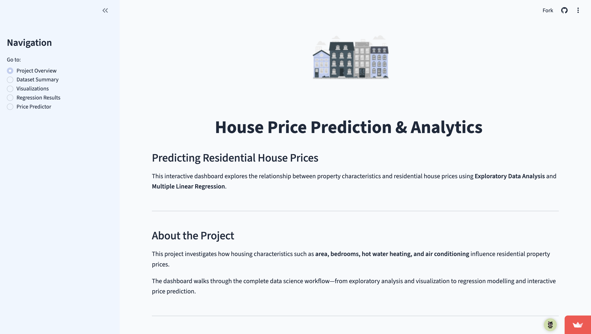
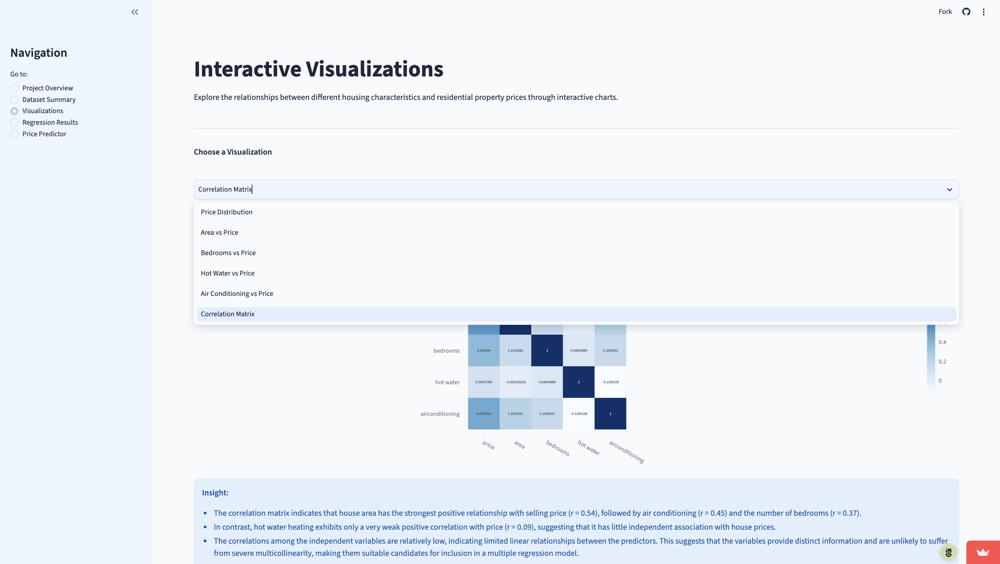
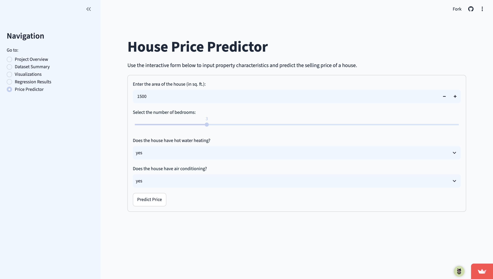

# Housing Price Predictor

[🚀 Launch Interactive Dashboard](https://housing-price-predictor-dashboard.streamlit.app/)

A data analysis and regression project for predicting residential house prices based on property characteristics.

## Overview

This project analyzes a residential housing dataset to understand which features are most associated with sale price and to estimate property values using multiple linear regression. The final output is a Streamlit dashboard that presents the core findings and allows users to input property values for price estimation.

## Dashboard Preview

### Project Overview


### Interactive Data Visualizations


### House Price Predictor


## Dataset

The project uses the dataset in `data/housing_data.csv`.

It contains 545 housing records and 5 variables:
- `price` — selling price of the property
- `area` — property size in square feet
- `bedrooms` — number of bedrooms
- `hot water` — whether the property has hot water heating (`yes` / `no`)
- `airconditioning` — whether the property has air conditioning (`yes` / `no`)

The dataset is complete and contains no missing values in the analyzed columns.

## Tools and Technologies

- Python
- Pandas
- NumPy
- Plotly
- Statsmodels
- Scikit-learn
- Streamlit
- Jupyter Notebook

## Methodology

1. Load and inspect the dataset
2. Review basic descriptive statistics and missing values
3. Explore relationships between predictors and price
4. Encode categorical variables for modeling
5. Build a multiple linear regression model
6. Evaluate the model and visualize results

## Key Features

- Interactive dashboard with sections for overview, dataset summary, visualizations, regression results, and price prediction
- Price distribution analysis
- Scatter and box plots for area, bedrooms, hot water, and air conditioning
- Correlation analysis
- Price prediction form for custom inputs

## Results and Insights

- Average property price is approximately ₹4.77M
- House area shows the strongest positive relationship with price
- Air conditioning is associated with higher prices; bedroom count is a weaker predictor than area
- The regression model achieved an in-sample R² of 0.481 and RMSE of approximately ₹1.35 million. These results describe its fit to the analyzed dataset rather than its performance on unseen properties.

## Model Limitation

The model is limited to the variables available in the dataset. It does not include factors such as location, neighborhood characteristics, property age, furnishing, or parking, which often influence real estate values. As a result, predictions may be less accurate for homes that fall outside the patterns represented in the training data.

## Repository Structure

```text
housing-price-predictor/
├── .streamlit/
│   └── config.toml
├── data/
│   └── housing_data.csv
├── images/
│   ├── landing_page.png
│   ├── visualization_page.png
│   ├── prediction_page.png
│   └── house_clip.png
├── notebooks/
│   └── data_explore.ipynb
├── app.py
├── charts.py
├── requirements.txt
├── .gitignore
├── README.md
```

## Run Locally

Install the dependencies:

```bash
pip install -r requirements.txt
```

Then start the app:

```bash
streamlit run app.py
```

Open the local URL shown in the terminal in your browser.

## Summary

This project demonstrates practical experience in data cleaning, exploratory analysis, visualization, and regression modeling. It is suitable for a portfolio focused on data analysis and predictive analytics.
